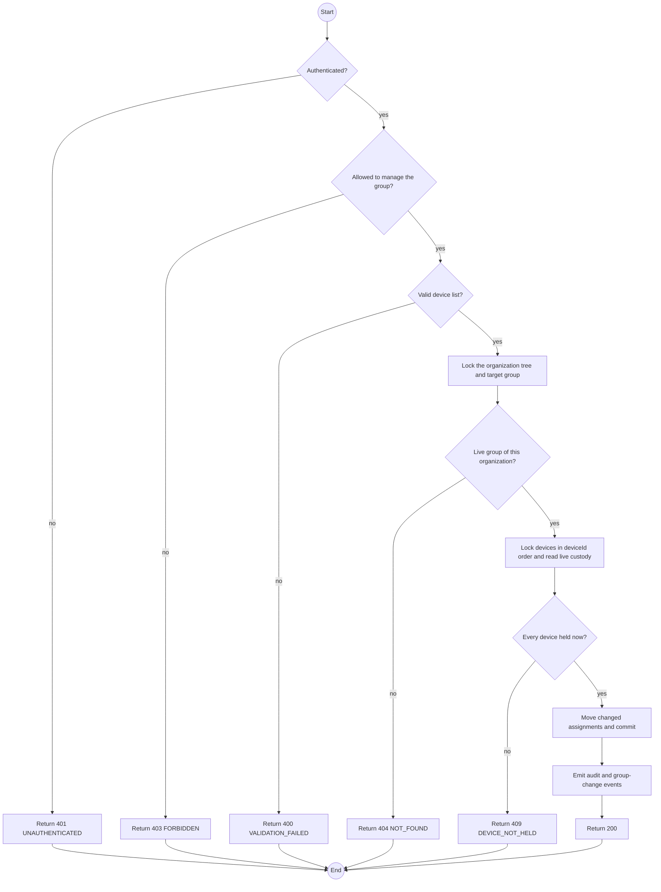
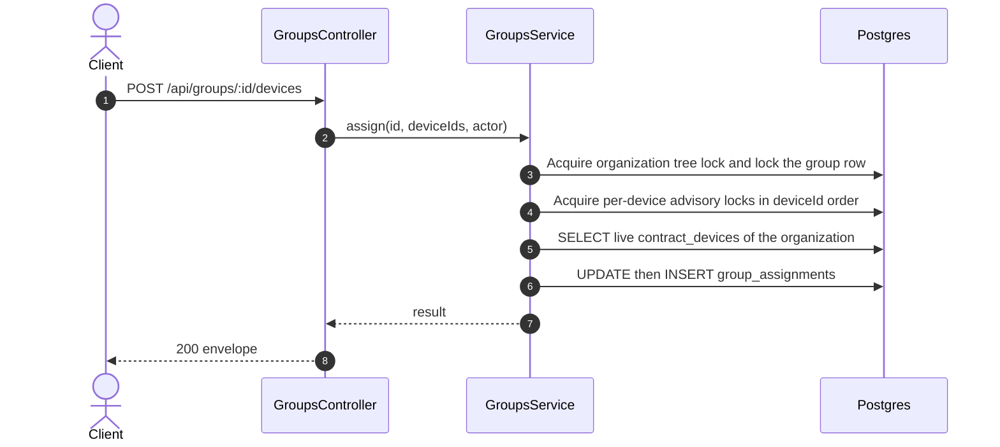

# POST /api/groups/:id/devices: Assign devices to a group

> Module `rentals`. Generated from `scripts/specs/endpoints/rentals.py` by `scripts/specs/build_api_design.py`; edit the catalog, not this file. Format: `02-templates/04-api-endpoint-template.md` with Mermaid (D-017). Envelope: D-002.

[TOC]

---
## Overview

Moves each named device into the group: its open assignment elsewhere ends `MOVED` and one opens here against its live contract row (FR-CON-18, BR-46). Every device must be held by the organization now; one that is not, its own returned device or another organization's, refuses the whole request with the same answer. A device already in the group is left as it is. Take the organization tree lock, the group row lock, then the device locks in ascending `deviceId` order before reading custody (design §11.4). Audited per device as `group.deviceAssigned`.

## API Specification

| API | URL |
| --- | --- |
| POST | /api/groups/:id/devices |
| Permission | Org Manager |
| Traces | UC-68, FR-CON-18, BR-46, E04-8, MSG17 |

### Path parameters

| Field | Description | Data Type | Examples |
| --- | --- | --- | --- |
| id | Group id; members may use only their own organization's | uuid | `g-1` |

## Request sample

```json
{
  "deviceIds": [
    "0d3f6a2b-7e11-4c55-8f0a-2b1c9e7d4a10"
  ]
}
```

| Field | Description | Data Type | Required | Examples |
| --- | --- | --- | --- | --- |
| deviceIds | 1 to 100 devices the organization holds | uuid[] | yes | `["0d3f6a2b-7e11-4c55-8f0a-2b1c9e7d4a10"]` |

## Response sample

```json
{
  "result": {
    "groupId": "g-2",
    "assigned": [
      "0d3f6a2b-7e11-4c55-8f0a-2b1c9e7d4a10"
    ],
    "unchanged": []
  },
  "isSuccess": true,
  "statusCode": 200,
  "message": "Devices assigned"
}
```

## Validation

<table>
    <th>Status code</th>
    <th>Description</th>
    <th>Examples</th>
    <tbody>
        <tr>
            <td>400</td>
            <td>The body or query fails validation (<code>VALIDATION_FAILED</code>)</td>
<td>

```json
{
  "result": {
    "errorCode": "VALIDATION_FAILED"
  },
  "isSuccess": false,
  "statusCode": 400,
  "message": "{field} is required."
}
```
</td>
        </tr>
        <tr>
            <td>401</td>
            <td>Missing, malformed or expired access token or API key (<code>UNAUTHENTICATED</code>)</td>
<td>

```json
{
  "result": {
    "errorCode": "UNAUTHENTICATED"
  },
  "isSuccess": false,
  "statusCode": 401,
  "message": "Authentication required."
}
```
</td>
        </tr>
        <tr>
            <td>403</td>
            <td>The caller's role, policy or organization does not allow this action (<code>FORBIDDEN</code>)</td>
<td>

```json
{
  "result": {
    "errorCode": "FORBIDDEN"
  },
  "isSuccess": false,
  "statusCode": 403,
  "message": "You do not have access to this."
}
```
</td>
        </tr>
        <tr>
            <td>404</td>
            <td>No such record, or it belongs to another organization (<code>NOT_FOUND</code>)</td>
<td>

```json
{
  "result": {
    "errorCode": "NOT_FOUND"
  },
  "isSuccess": false,
  "statusCode": 404,
  "message": "Group assignment not found."
}
```
</td>
        </tr>
        <tr>
            <td>400</td>
            <td>No device, or more than 100 (<code>VALIDATION_FAILED</code>)</td>
<td>

```json
{
  "result": {
    "errorCode": "VALIDATION_FAILED"
  },
  "isSuccess": false,
  "statusCode": 400,
  "message": "deviceIds must name 1 to 100 devices."
}
```
</td>
        </tr>
        <tr>
            <td>404</td>
            <td>Not a live group of the organization (<code>NOT_FOUND</code>)</td>
<td>

```json
{
  "result": {
    "errorCode": "NOT_FOUND"
  },
  "isSuccess": false,
  "statusCode": 404,
  "message": "Not found."
}
```
</td>
        </tr>
        <tr>
            <td>409</td>
            <td>A device has no live, handed-over row on a contract of the organization (<code>DEVICE_NOT_HELD</code>)</td>
<td>

```json
{
  "result": {
    "errorCode": "DEVICE_NOT_HELD"
  },
  "isSuccess": false,
  "statusCode": 409,
  "message": "This device is not held by your organization now."
}
```
</td>
        </tr>
    </tbody>
</table>

## Activity Diagram



## Sequence Diagram


