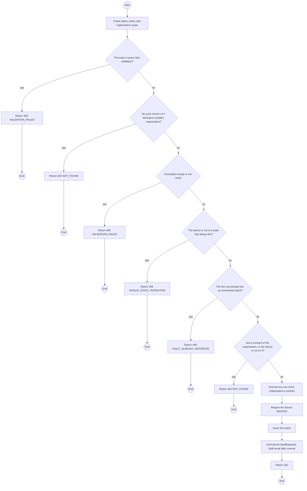
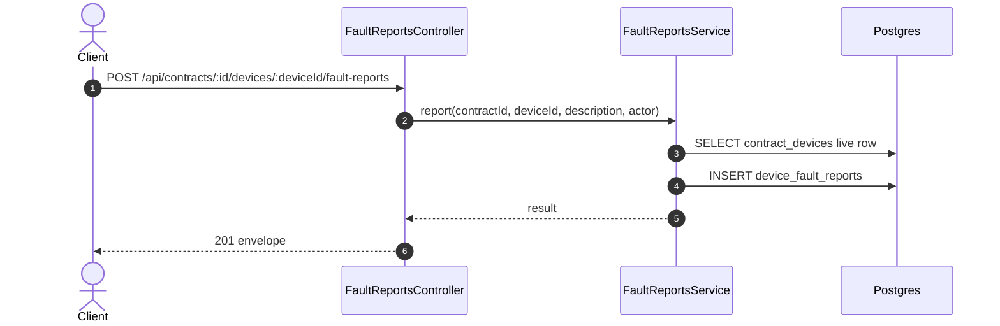

# POST /api/contracts/:id/devices/:deviceId/fault-reports: Report a device fault

> Module `rentals`. Generated from `scripts/specs/endpoints/rentals.py` by `scripts/specs/build_api_design.py`; edit the catalog, not this file. Format: `02-templates/04-api-endpoint-template.md` with Mermaid (D-017). Envelope: D-002.

[TOC]

---
## Overview

Records a fault on a `RENTED` device of one of the organization's contracts against its live row, with the reporter and the UTC time, and emails TrekLink Staff after commit (MSG41, FR-CON-19). The device stays `RENTED`; the report is resolved when its custody row closes, with `REPLACED`, `CHECKED_IN`, `LOST` or `RELEASED` (design §11.4). A service credit may name the report as the source of its outage start (billing task 8.3).

## API Specification

| API | URL |
| --- | --- |
| POST | /api/contracts/:id/devices/:deviceId/fault-reports |
| Permission | Org Manager |
| Traces | UC-69, FR-CON-19, MSG41 |

### Path parameters

| Field | Description | Data Type | Examples |
| --- | --- | --- | --- |
| id | Contract id; members may use only their own organization's | uuid | `c0ffee00-1234-4abc-9def-001122334455` |
| deviceId | Device committed to the contract | uuid | `0d3f6a2b-7e11-4c55-8f0a-2b1c9e7d4a10` |

## Request sample

```json
{
  "description": "Battery swollen, will not charge"
}
```

| Field | Description | Data Type | Required | Examples |
| --- | --- | --- | --- | --- |
| description | What is wrong, 1 to 1000 characters | string | yes | `Battery swollen, will not charge` |

## Response sample

```json
{
  "result": {
    "id": "fr-1",
    "contractId": "c0ffee00-1234-4abc-9def-001122334455",
    "contractDeviceId": "cd-1",
    "deviceId": "0d3f6a2b-7e11-4c55-8f0a-2b1c9e7d4a10",
    "description": "Battery swollen, will not charge",
    "reportedBy": {
      "id": "3f2e1d0c-9b8a-4c7d-8e6f-5a4b3c2d1e0f"
    },
    "reportedAt": "2026-10-20T03:15:00.000Z",
    "resolvedAt": null,
    "resolution": null
  },
  "isSuccess": true,
  "statusCode": 201,
  "message": "Fault reported. TrekLink will contact you about a replacement."
}
```

## Validation

<table>
    <th>Status code</th>
    <th>Description</th>
    <th>Examples</th>
    <tbody>
        <tr>
            <td>400</td>
            <td>The body or query fails validation (<code>VALIDATION_FAILED</code>)</td>
<td>

```json
{
  "result": {
    "errorCode": "VALIDATION_FAILED"
  },
  "isSuccess": false,
  "statusCode": 400,
  "message": "{field} is required."
}
```
</td>
        </tr>
        <tr>
            <td>401</td>
            <td>Missing, malformed or expired access token or API key (<code>UNAUTHENTICATED</code>)</td>
<td>

```json
{
  "result": {
    "errorCode": "UNAUTHENTICATED"
  },
  "isSuccess": false,
  "statusCode": 401,
  "message": "Authentication required."
}
```
</td>
        </tr>
        <tr>
            <td>403</td>
            <td>The caller's role, policy or organization does not allow this action (<code>FORBIDDEN</code>)</td>
<td>

```json
{
  "result": {
    "errorCode": "FORBIDDEN"
  },
  "isSuccess": false,
  "statusCode": 403,
  "message": "You do not have access to this."
}
```
</td>
        </tr>
        <tr>
            <td>404</td>
            <td>No such record, or it belongs to another organization (<code>NOT_FOUND</code>)</td>
<td>

```json
{
  "result": {
    "errorCode": "NOT_FOUND"
  },
  "isSuccess": false,
  "statusCode": 404,
  "message": "Fault report not found."
}
```
</td>
        </tr>
        <tr>
            <td>400</td>
            <td>Description empty or too long (<code>VALIDATION_FAILED</code>)</td>
<td>

```json
{
  "result": {
    "errorCode": "VALIDATION_FAILED"
  },
  "isSuccess": false,
  "statusCode": 400,
  "message": "description must be 1 to 1000 characters."
}
```
</td>
        </tr>
        <tr>
            <td>409</td>
            <td>The device is not in a state that allows this (<code>INVALID_STATE_TRANSITION</code>)</td>
<td>

```json
{
  "result": {
    "errorCode": "INVALID_STATE_TRANSITION"
  },
  "isSuccess": false,
  "statusCode": 409,
  "message": "This cannot be done while it is RETURNED."
}
```
</td>
        </tr>
        <tr>
            <td>409</td>
            <td>The live row already has an unresolved report (<code>FAULT_ALREADY_REPORTED</code>)</td>
<td>

```json
{
  "result": {
    "errorCode": "FAULT_ALREADY_REPORTED",
    "reportId": "fr-1"
  },
  "isSuccess": false,
  "statusCode": 409,
  "message": "A fault on this device is already reported."
}
```
</td>
        </tr>
        <tr>
            <td>404</td>
            <td>Not a contract of the organization, or the device is not on it (<code>NOT_FOUND</code>)</td>
<td>

```json
{
  "result": {
    "errorCode": "NOT_FOUND"
  },
  "isSuccess": false,
  "statusCode": 404,
  "message": "Not found."
}
```
</td>
        </tr>
    </tbody>
</table>

## Activity Diagram



## Sequence Diagram


