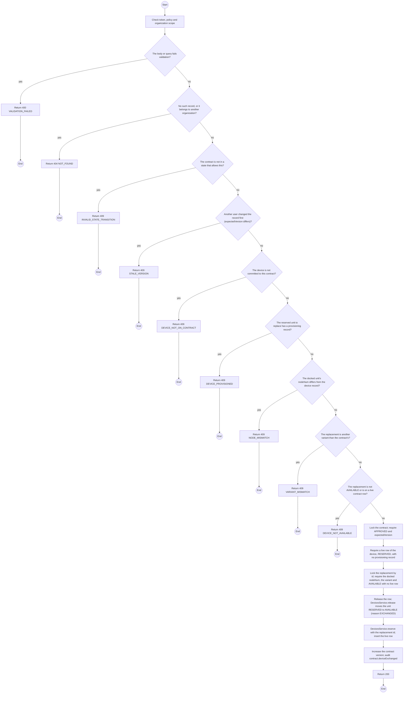
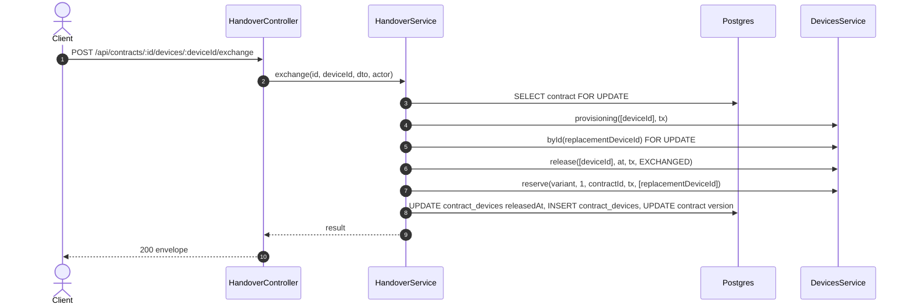

# POST /api/contracts/:id/devices/:deviceId/exchange: Exchange a reserved device for a docked unit

> Module `rentals`. Generated from `scripts/specs/endpoints/rentals.py` by `scripts/specs/build_api_design.py`; edit the catalog, not this file. Format: `02-templates/04-api-endpoint-template.md` with Mermaid (D-017). Envelope: D-002.

[TOC]

---
## Overview

The quick swap at the counter (devices design §11.6): an `AVAILABLE` unit of the contract's variant, docked on the Staff computer, takes the place of a reserved unit that has no provisioning record. The replaced unit goes back to `AVAILABLE` with no maintenance record (unlike api-design 07, which sends a unit that failed its check to `MAINTENANCE`); the docked unit becomes `RESERVED` to the contract; quantity, plan, price and variant do not change (REQ-UBI-03). The docked `nodeNum` must equal the replacement's record (devices REQ-EVT-33, D-080). The counter then provisions the docked unit at once (devices REQ-EVT-34). The contract `version` increases, so a signing screen opened before the exchange reloads. Devices design §11.12 Q1 and Q2 were decided A on 2026-11-04. Permission `contract.operate`, the one of api-design 07.

## API Specification

| API | URL |
| --- | --- |
| POST | /api/contracts/:id/devices/:deviceId/exchange |
| Permission | TrekLink Staff |
| Traces | UC-14, UC-20, FR-CON-05, FR-DEV-05, BR-03, BR-09, E01-5, D-080 |

### Path parameters

| Field | Description | Data Type | Examples |
| --- | --- | --- | --- |
| id | Contract id; members may use only their own organization's | uuid | `c0ffee00-1234-4abc-9def-001122334455` |
| deviceId | Device committed to the contract | uuid | `0d3f6a2b-7e11-4c55-8f0a-2b1c9e7d4a10` |

## Request sample

```json
{
  "replacementDeviceId": "8f9e0a1b-2c3d-4e5f-8a9b-0c1d2e3f4a5b",
  "nodeNum": 2763113188,
  "expectedVersion": 4
}
```

| Field | Description | Data Type | Required | Examples |
| --- | --- | --- | --- | --- |
| replacementDeviceId | The docked unit to reserve in its place | uuid | yes | `8f9e0a1b-...` |
| nodeNum | The nodeNum read from the docked unit; must equal the replacement's record | int | yes | `2763113188` |
| expectedVersion | Contract version the caller saw | int | yes | `4` |

## Response sample

```json
{
  "result": {
    "released": {
      "deviceId": "0d3f6a2b-7e11-4c55-8f0a-2b1c9e7d4a10",
      "assetTag": "TL-0001",
      "status": "AVAILABLE"
    },
    "reserved": {
      "deviceId": "8f9e0a1b-2c3d-4e5f-8a9b-0c1d2e3f4a5b",
      "assetTag": "TL-0051",
      "nodeNum": 2763113188,
      "status": "RESERVED"
    },
    "contractVersion": 5
  },
  "isSuccess": true,
  "statusCode": 200,
  "message": "TL-0051 replaces TL-0001 on RC-2026-0042."
}
```

## Validation

<table>
    <th>Status code</th>
    <th>Description</th>
    <th>Examples</th>
    <tbody>
        <tr>
            <td>400</td>
            <td>The body or query fails validation (<code>VALIDATION_FAILED</code>)</td>
<td>

```json
{
  "result": {
    "errorCode": "VALIDATION_FAILED"
  },
  "isSuccess": false,
  "statusCode": 400,
  "message": "{field} is required."
}
```
</td>
        </tr>
        <tr>
            <td>401</td>
            <td>Missing, malformed or expired access token or API key (<code>UNAUTHENTICATED</code>)</td>
<td>

```json
{
  "result": {
    "errorCode": "UNAUTHENTICATED"
  },
  "isSuccess": false,
  "statusCode": 401,
  "message": "Authentication required."
}
```
</td>
        </tr>
        <tr>
            <td>403</td>
            <td>The caller's role, policy or organization does not allow this action (<code>FORBIDDEN</code>)</td>
<td>

```json
{
  "result": {
    "errorCode": "FORBIDDEN"
  },
  "isSuccess": false,
  "statusCode": 403,
  "message": "You do not have access to this."
}
```
</td>
        </tr>
        <tr>
            <td>404</td>
            <td>No such record, or it belongs to another organization (<code>NOT_FOUND</code>)</td>
<td>

```json
{
  "result": {
    "errorCode": "NOT_FOUND"
  },
  "isSuccess": false,
  "statusCode": 404,
  "message": "Contract not found."
}
```
</td>
        </tr>
        <tr>
            <td>409</td>
            <td>The contract is not in a state that allows this (<code>INVALID_STATE_TRANSITION</code>)</td>
<td>

```json
{
  "result": {
    "errorCode": "INVALID_STATE_TRANSITION"
  },
  "isSuccess": false,
  "statusCode": 409,
  "message": "This cannot be done while it is ACTIVE."
}
```
</td>
        </tr>
        <tr>
            <td>409</td>
            <td>Another user changed the record first (expectedVersion differs) (<code>STALE_VERSION</code>)</td>
<td>

```json
{
  "result": {
    "errorCode": "STALE_VERSION"
  },
  "isSuccess": false,
  "statusCode": 409,
  "message": "This was changed by someone else. Reload and try again."
}
```
</td>
        </tr>
        <tr>
            <td>409</td>
            <td>The device is not committed to this contract (<code>DEVICE_NOT_ON_CONTRACT</code>)</td>
<td>

```json
{
  "result": {
    "errorCode": "DEVICE_NOT_ON_CONTRACT"
  },
  "isSuccess": false,
  "statusCode": 409,
  "message": "TL-0042 does not belong to contract RC-2026-0042."
}
```
</td>
        </tr>
        <tr>
            <td>409</td>
            <td>The reserved unit to replace has a provisioning record (<code>DEVICE_PROVISIONED</code>)</td>
<td>

```json
{
  "result": {
    "errorCode": "DEVICE_PROVISIONED"
  },
  "isSuccess": false,
  "statusCode": 409,
  "message": "TL-0001 is provisioned. Only units not provisioned can be swapped out."
}
```
</td>
        </tr>
        <tr>
            <td>409</td>
            <td>The docked unit's nodeNum differs from the device record (<code>NODE_MISMATCH</code>)</td>
<td>

```json
{
  "result": {
    "errorCode": "NODE_MISMATCH"
  },
  "isSuccess": false,
  "statusCode": 409,
  "message": "The docked unit is !0004351c, not TL-0042. Nothing was written."
}
```
</td>
        </tr>
        <tr>
            <td>409</td>
            <td>The replacement is another variant than the contract's (<code>VARIANT_MISMATCH</code>)</td>
<td>

```json
{
  "result": {
    "errorCode": "VARIANT_MISMATCH"
  },
  "isSuccess": false,
  "statusCode": 409,
  "message": "TL-0051 is treklink-v2; RC-2026-0042 rents treklink-v3."
}
```
</td>
        </tr>
        <tr>
            <td>409</td>
            <td>The replacement is not AVAILABLE or is on a live contract row (<code>DEVICE_NOT_AVAILABLE</code>)</td>
<td>

```json
{
  "result": {
    "errorCode": "DEVICE_NOT_AVAILABLE"
  },
  "isSuccess": false,
  "statusCode": 409,
  "message": "TL-0051 is not available. It is reserved to RC-2026-0040."
}
```
</td>
        </tr>
    </tbody>
</table>

## Activity Diagram



## Sequence Diagram


