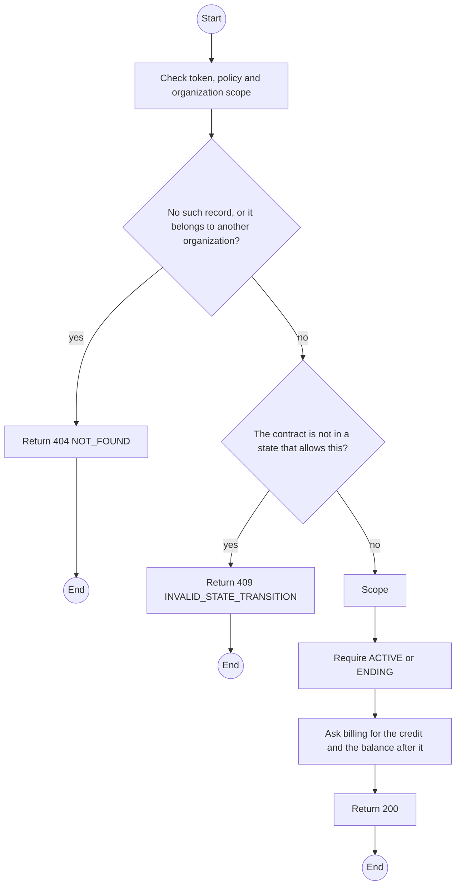
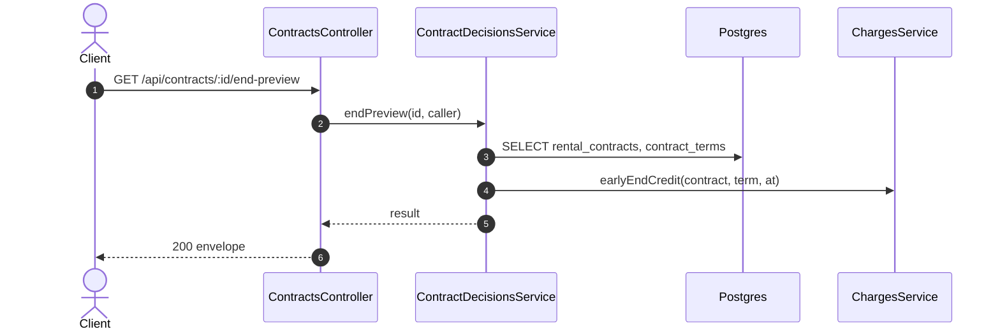

# GET /api/contracts/:id/end-preview: Preview ending a contract now

> Module `rentals`. Generated from `scripts/specs/endpoints/rentals.py` by `scripts/specs/build_api_design.py`; edit the catalog, not this file. Format: `02-templates/04-api-endpoint-template.md` with Mermaid (D-017). Envelope: D-002.

[TOC]

---
## Overview

What End now would do at the current minute, for the confirmation dialog: the end time, the current term, its fee, the used and unused days, the credit, what the contract would still owe and what would be owed to the organization. Computed by `billing` as the action computes it; nothing is stored (REQ-EVT-28). A day plan answers a zero credit.

## API Specification

| API | URL |
| --- | --- |
| GET | /api/contracts/:id/end-preview |
| Permission | TrekLink Staff, TrekLink Admin; Org Manager: own |
| Traces | D-097 |

### Path parameters

| Field | Description | Data Type | Examples |
| --- | --- | --- | --- |
| id | Contract id; members may use only their own organization's | uuid | `c0ffee00-1234-4abc-9def-001122334455` |

## Request sample

No body.

## Response sample

```json
{
  "result": {
    "contractId": "c0ffee00-1234-4abc-9def-001122334455",
    "code": "RC-2026-0042",
    "planType": "MONTHLY",
    "endsAt": "2026-11-06T03:00:00.000Z",
    "term": {
      "seq": 2,
      "startsAt": "2026-11-01T02:00:00.000Z",
      "endsAt": "2026-12-01T02:00:00.000Z"
    },
    "termFeeVnd": 4500000,
    "termDays": 30,
    "usedDays": 6,
    "unusedDays": 24,
    "creditVnd": 3600000,
    "outstandingVnd": 0,
    "owedToOrganizationVnd": 3600000
  },
  "isSuccess": true,
  "statusCode": 200,
  "message": "OK"
}
```

## Validation

<table>
    <th>Status code</th>
    <th>Description</th>
    <th>Examples</th>
    <tbody>
        <tr>
            <td>401</td>
            <td>Missing, malformed or expired access token or API key (<code>UNAUTHENTICATED</code>)</td>
<td>

```json
{
  "result": {
    "errorCode": "UNAUTHENTICATED"
  },
  "isSuccess": false,
  "statusCode": 401,
  "message": "Authentication required."
}
```
</td>
        </tr>
        <tr>
            <td>403</td>
            <td>The caller's role, policy or organization does not allow this action (<code>FORBIDDEN</code>)</td>
<td>

```json
{
  "result": {
    "errorCode": "FORBIDDEN"
  },
  "isSuccess": false,
  "statusCode": 403,
  "message": "You do not have access to this."
}
```
</td>
        </tr>
        <tr>
            <td>404</td>
            <td>No such record, or it belongs to another organization (<code>NOT_FOUND</code>)</td>
<td>

```json
{
  "result": {
    "errorCode": "NOT_FOUND"
  },
  "isSuccess": false,
  "statusCode": 404,
  "message": "Contract not found."
}
```
</td>
        </tr>
        <tr>
            <td>409</td>
            <td>The contract is not in a state that allows this (<code>INVALID_STATE_TRANSITION</code>)</td>
<td>

```json
{
  "result": {
    "errorCode": "INVALID_STATE_TRANSITION"
  },
  "isSuccess": false,
  "statusCode": 409,
  "message": "This cannot be done while it is RETURN_DUE."
}
```
</td>
        </tr>
    </tbody>
</table>

## Activity Diagram



## Sequence Diagram


