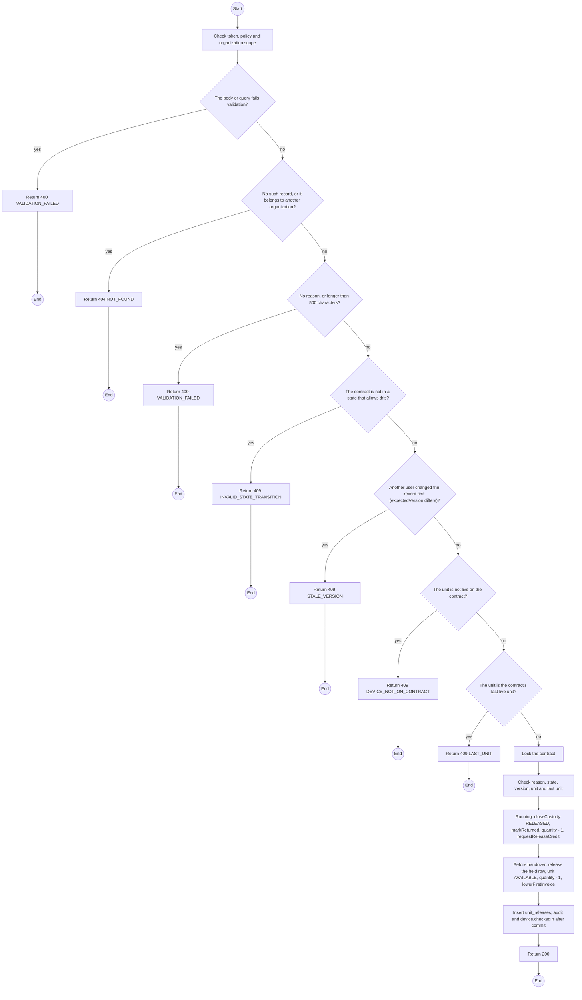
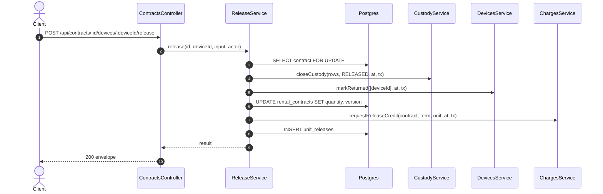

# POST /api/contracts/:id/devices/:deviceId/release: Release a unit

> Module `rentals`. Generated from `scripts/specs/endpoints/rentals.py` by `scripts/specs/build_api_design.py`; edit the catalog, not this file. Format: `02-templates/04-api-endpoint-template.md` with Mermaid (D-017). Envelope: D-002.

[TOC]

---
## Overview

Gives one unit back before the term end (D-099, design §13). On an `ACTIVE` or `ENDING` contract the unit must be back at the counter: its custody row closes `RELEASED` and is stamped checked in, its group assignment ends and its open fault report resolves, the unit goes `RETURNED` for its reset and inspection, and a monthly contract with an open term gets a release credit `REQUESTED` for the unused whole days, which an Admin decides in the service credit queue (billing design §12.1). On a `REQUESTED` or `APPROVED` contract the held unit goes back to `AVAILABLE` and the first invoice is lowered to the new quantity (billing design §12.2). Either way the quantity drops by one, the minimum order quantity is not checked, and the last unit is refused. Audited as `contract.unitReleased`.

## API Specification

| API | URL |
| --- | --- |
| POST | /api/contracts/:id/devices/:deviceId/release |
| Permission | TrekLink Staff |
| Traces | D-099, BR-05 as amended, REQ-EVT-31, REQ-EVT-32, REQ-ERR-19, REQ-ERR-20 |

### Path parameters

| Field | Description | Data Type | Examples |
| --- | --- | --- | --- |
| id | Contract id; members may use only their own organization's | uuid | `c0ffee00-1234-4abc-9def-001122334455` |
| deviceId | Device committed to the contract | uuid | `0d3f6a2b-7e11-4c55-8f0a-2b1c9e7d4a10` |

## Request sample

```json
{
  "reason": "The group shrank to 4 trekkers",
  "expectedVersion": 9
}
```

| Field | Description | Data Type | Required | Examples |
| --- | --- | --- | --- | --- |
| reason | Why the organization gives the unit back, 1 to 500 characters | string | yes | `The group shrank to 4 trekkers` |
| expectedVersion | Contract version the caller saw | int | yes | `4` |

## Response sample

```json
{
  "result": {
    "release": {
      "id": "ur-1",
      "contractId": "c0ffee00-1234-4abc-9def-001122334455",
      "deviceId": "0d3f6a2b-7e11-4c55-8f0a-2b1c9e7d4a10",
      "phase": "RUNNING",
      "reason": "The group shrank to 4 trekkers",
      "releasedAt": "2026-10-20T03:15:00.000Z",
      "quantityBefore": 5,
      "quantityAfter": 4,
      "serviceCreditId": "sc-7"
    },
    "contract": {
      "id": "c0ffee00-1234-4abc-9def-001122334455",
      "quantity": 4,
      "version": 10
    },
    "credit": {
      "id": "sc-7",
      "kind": "RELEASE",
      "status": "REQUESTED",
      "computedVnd": 300000,
      "unusedDays": 20,
      "termDays": 30
    }
  },
  "isSuccess": true,
  "statusCode": 200,
  "message": "Unit released"
}
```

## Validation

<table>
    <th>Status code</th>
    <th>Description</th>
    <th>Examples</th>
    <tbody>
        <tr>
            <td>400</td>
            <td>The body or query fails validation (<code>VALIDATION_FAILED</code>)</td>
<td>

```json
{
  "result": {
    "errorCode": "VALIDATION_FAILED"
  },
  "isSuccess": false,
  "statusCode": 400,
  "message": "{field} is required."
}
```
</td>
        </tr>
        <tr>
            <td>401</td>
            <td>Missing, malformed or expired access token or API key (<code>UNAUTHENTICATED</code>)</td>
<td>

```json
{
  "result": {
    "errorCode": "UNAUTHENTICATED"
  },
  "isSuccess": false,
  "statusCode": 401,
  "message": "Authentication required."
}
```
</td>
        </tr>
        <tr>
            <td>403</td>
            <td>The caller's role, policy or organization does not allow this action (<code>FORBIDDEN</code>)</td>
<td>

```json
{
  "result": {
    "errorCode": "FORBIDDEN"
  },
  "isSuccess": false,
  "statusCode": 403,
  "message": "You do not have access to this."
}
```
</td>
        </tr>
        <tr>
            <td>404</td>
            <td>No such record, or it belongs to another organization (<code>NOT_FOUND</code>)</td>
<td>

```json
{
  "result": {
    "errorCode": "NOT_FOUND"
  },
  "isSuccess": false,
  "statusCode": 404,
  "message": "Unit release not found."
}
```
</td>
        </tr>
        <tr>
            <td>400</td>
            <td>No reason, or longer than 500 characters (<code>VALIDATION_FAILED</code>)</td>
<td>

```json
{
  "result": {
    "errorCode": "VALIDATION_FAILED"
  },
  "isSuccess": false,
  "statusCode": 400,
  "message": "reason must be 1 to 500 characters."
}
```
</td>
        </tr>
        <tr>
            <td>409</td>
            <td>The contract is not in a state that allows this (<code>INVALID_STATE_TRANSITION</code>)</td>
<td>

```json
{
  "result": {
    "errorCode": "INVALID_STATE_TRANSITION"
  },
  "isSuccess": false,
  "statusCode": 409,
  "message": "This cannot be done while it is RETURN_DUE."
}
```
</td>
        </tr>
        <tr>
            <td>409</td>
            <td>Another user changed the record first (expectedVersion differs) (<code>STALE_VERSION</code>)</td>
<td>

```json
{
  "result": {
    "errorCode": "STALE_VERSION"
  },
  "isSuccess": false,
  "statusCode": 409,
  "message": "This was changed by someone else. Reload and try again."
}
```
</td>
        </tr>
        <tr>
            <td>409</td>
            <td>The unit is not live on the contract (<code>DEVICE_NOT_ON_CONTRACT</code>)</td>
<td>

```json
{
  "result": {
    "errorCode": "DEVICE_NOT_ON_CONTRACT"
  },
  "isSuccess": false,
  "statusCode": 409,
  "message": "TL-0042 does not belong to contract RC-2026-0042."
}
```
</td>
        </tr>
        <tr>
            <td>409</td>
            <td>The unit is the contract's last live unit (<code>LAST_UNIT</code>)</td>
<td>

```json
{
  "result": {
    "errorCode": "LAST_UNIT"
  },
  "isSuccess": false,
  "statusCode": 409,
  "message": "This is the last unit. End the contract now instead."
}
```
</td>
        </tr>
    </tbody>
</table>

## Activity Diagram



## Sequence Diagram


