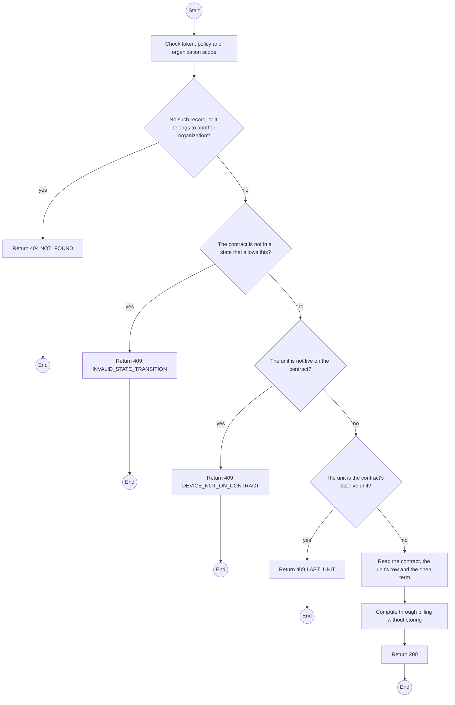
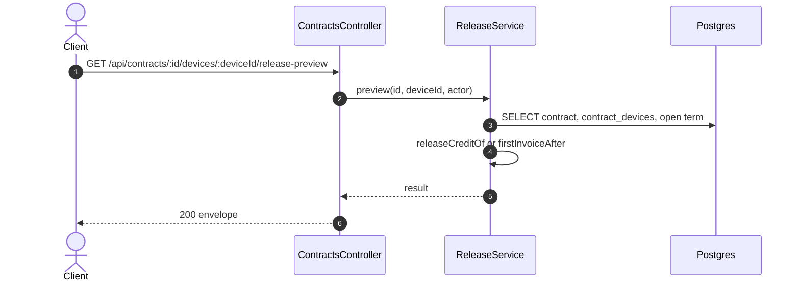

# GET /api/contracts/:id/devices/:deviceId/release-preview: Preview a unit release

> Module `rentals`. Generated from `scripts/specs/endpoints/rentals.py` by `scripts/specs/build_api_design.py`; edit the catalog, not this file. Format: `02-templates/04-api-endpoint-template.md` with Mermaid (D-017). Envelope: D-002.

[TOC]

---
## Overview

What releasing the unit now would do, for the confirmation dialog: the quantity after it, and either the release credit (unused and term days, the amount the Admin will decide) or that none applies (a day plan, no open term, the term's last day), or, before the handover, the first invoice's new total and what would be owed to the organization. Nothing is stored or locked (REQ-EVT-33). The same refusals as the release apply, except the version.

## API Specification

| API | URL |
| --- | --- |
| GET | /api/contracts/:id/devices/:deviceId/release-preview |
| Permission | TrekLink Staff |
| Traces | D-099, REQ-EVT-33 |

### Path parameters

| Field | Description | Data Type | Examples |
| --- | --- | --- | --- |
| id | Contract id; members may use only their own organization's | uuid | `c0ffee00-1234-4abc-9def-001122334455` |
| deviceId | Device committed to the contract | uuid | `0d3f6a2b-7e11-4c55-8f0a-2b1c9e7d4a10` |

## Request sample

No body.

## Response sample

```json
{
  "result": {
    "phase": "RUNNING",
    "quantityBefore": 5,
    "quantityAfter": 4,
    "lastUnit": false,
    "credit": {
      "applies": true,
      "unusedDays": 20,
      "termDays": 30,
      "computedVnd": 300000
    },
    "firstInvoice": null
  },
  "isSuccess": true,
  "statusCode": 200,
  "message": "OK"
}
```

## Validation

<table>
    <th>Status code</th>
    <th>Description</th>
    <th>Examples</th>
    <tbody>
        <tr>
            <td>401</td>
            <td>Missing, malformed or expired access token or API key (<code>UNAUTHENTICATED</code>)</td>
<td>

```json
{
  "result": {
    "errorCode": "UNAUTHENTICATED"
  },
  "isSuccess": false,
  "statusCode": 401,
  "message": "Authentication required."
}
```
</td>
        </tr>
        <tr>
            <td>403</td>
            <td>The caller's role, policy or organization does not allow this action (<code>FORBIDDEN</code>)</td>
<td>

```json
{
  "result": {
    "errorCode": "FORBIDDEN"
  },
  "isSuccess": false,
  "statusCode": 403,
  "message": "You do not have access to this."
}
```
</td>
        </tr>
        <tr>
            <td>404</td>
            <td>No such record, or it belongs to another organization (<code>NOT_FOUND</code>)</td>
<td>

```json
{
  "result": {
    "errorCode": "NOT_FOUND"
  },
  "isSuccess": false,
  "statusCode": 404,
  "message": "Unit release not found."
}
```
</td>
        </tr>
        <tr>
            <td>409</td>
            <td>The contract is not in a state that allows this (<code>INVALID_STATE_TRANSITION</code>)</td>
<td>

```json
{
  "result": {
    "errorCode": "INVALID_STATE_TRANSITION"
  },
  "isSuccess": false,
  "statusCode": 409,
  "message": "This cannot be done while it is RETURN_DUE."
}
```
</td>
        </tr>
        <tr>
            <td>409</td>
            <td>The unit is not live on the contract (<code>DEVICE_NOT_ON_CONTRACT</code>)</td>
<td>

```json
{
  "result": {
    "errorCode": "DEVICE_NOT_ON_CONTRACT"
  },
  "isSuccess": false,
  "statusCode": 409,
  "message": "TL-0042 does not belong to contract RC-2026-0042."
}
```
</td>
        </tr>
        <tr>
            <td>409</td>
            <td>The unit is the contract's last live unit (<code>LAST_UNIT</code>)</td>
<td>

```json
{
  "result": {
    "errorCode": "LAST_UNIT"
  },
  "isSuccess": false,
  "statusCode": 409,
  "message": "This is the last unit. End the contract now instead."
}
```
</td>
        </tr>
    </tbody>
</table>

## Activity Diagram



## Sequence Diagram


