# Technical Design: rentals

> Fulfills `requirements.md` in this folder. Schema: the `// @module rentals` block of
> `backend/prisma/schema.prisma` is authoritative.
>
> **Status**: Approved, written by KhoaDD and merged on `dev` (treklink-web PR #30 and #31, 2026-10-18). Changes go through a pull request reviewed by KhoaDD (D-052).

---

## 1. Data model

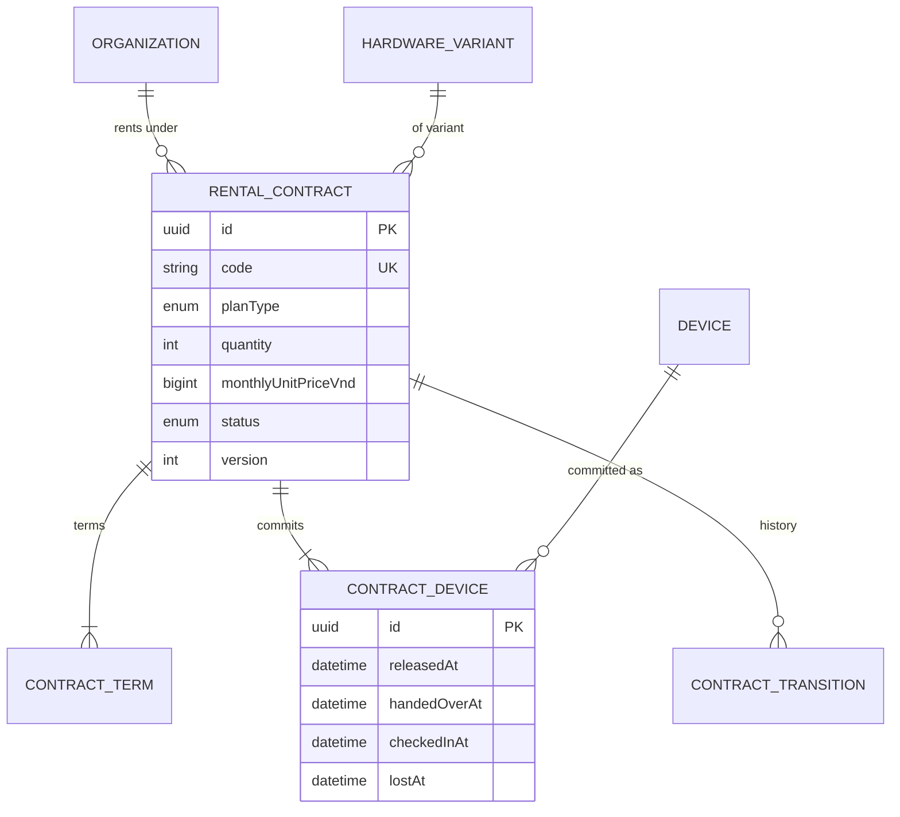

***Figure 1***: rentals slice. A `ContractDevice` row is live while `releasedAt`, `checkedInAt` and
`lostAt` are all null; one live row per device (BR-03).

---

## 2. Rental-contract lifecycle (D-035)

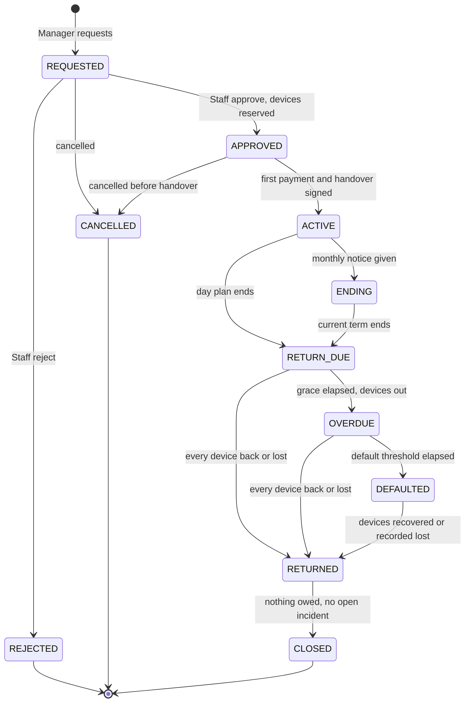

***Figure 2***: Rental-contract lifecycle; SRS Figure 29. Devices checked in early, while a day plan is
`ACTIVE` or a monthly contract `ENDING`, stay checked in; when the plan or term ends, the job moves the
contract to `RETURN_DUE` and, finding every device back or lost, straight on to `RETURNED` in the same
transaction. No edge outside D-035 is needed.

| From | To | Trigger | Actor |
|---|---|---|---|
| `REQUESTED` | `APPROVED`, `REJECTED` | approve, reject | Staff |
| `REQUESTED`, `APPROVED` | `CANCELLED` | cancel | Manager, Staff |
| `APPROVED` | `ACTIVE` | handover | Staff |
| `ACTIVE` | `ENDING` | notice (monthly) | Manager |
| `ACTIVE` | `RETURN_DUE` | day plan end | `SYSTEM` |
| `ENDING` | `RETURN_DUE` | term end | `SYSTEM` |
| `RETURN_DUE` | `OVERDUE` | grace elapsed | `SYSTEM` |
| `OVERDUE` | `DEFAULTED` | default threshold | `SYSTEM` (suspends the organization) |
| `RETURN_DUE`, `OVERDUE`, `DEFAULTED` | `RETURNED` | last device checked in or lost | Staff at check-in; the Admin settling the last loss case (`RentalsLossCaseListener`, reason `LOST`, REQ-EVT-12) |
| `RETURNED` | `CLOSED` | close | Staff |

`returnDueAt` is the day-plan end, or the current term's end for an `ENDING` contract.

---

## 3. Terms and money

Terms are anchored to the **requested start date** at 09:00 UTC+7, not to the handover moment, so an
invoice's due dates are known when it is issued and never move (REQ-UBI-02 of `billing`). A **monthly**
contract's term *n* runs from the start date plus *n−1* calendar months to plus *n* months. At approval
term 1 is created and `billing.issueTermInvoice(contract, term, tx)` issues one invoice with two dated
lines (D-037): the holding fee (ratio × monthly unit price × quantity) due at the term start, and the
balance due at the term end. The handover may happen on the start date or later; a later handover does not
move the term, so Staff reschedule by rejecting and re-requesting before approval if the date slips. A
handover before the start date is refused. At each term end the rollover job, in one transaction, closes
the term and either opens the next with its invoice (no notice) or moves the contract to `RETURN_DUE`
(after notice).

A **day plan** has one term from the start date for its length, created at approval; its invoice has one `DAY_PLAN_FEE` line due at the start date, paid at the latest at the counter.

Every charge is computed by `billing` from the contract's snapshot; this module never does money
arithmetic.

---

## 4. Handover at the counter

1. Staff open the approved contract; the counter app lists the reserved devices.
2. Each device: Staff write the organization channel key with the provisioning tool, then record it
   (`POST .../provisioning`); the platform keeps only the key version (D-021).
3. Each device: battery and GPS fix are checked; a failing unit is swapped (E01-5).
4. The Manager reads the preview note and signs on the screen; Staff enter the identity document seen.
5. `HandoverService.complete` checks the first payment through `billing`, readiness through `devices`,
   renders the PDF with the signature, stores it under `HANDOVER_NOTE_STORAGE_DIR` with its SHA-256, and
   commits the `RENTED` devices and `ACTIVE` together.

**Undoing a provisioning record** (api-design 19, REQ-EVT-16, REQ-ERR-10; dry run 2026-10-30, defect 5).
A provisioning recorded on the wrong unit is undone at the counter before the handover. The permission is
the one of api-design 09 (`contract.operate`, TrekLink Staff). `HandoverService.undoProvisioning` locks
the contract, checks the `expectedVersion` (409 `STALE_VERSION`) and the `APPROVED` state, finds the
unit's live row (409 `DEVICE_NOT_ON_CONTRACT`) and requires the unit `RESERVED` with no `handedOverAt`
(409 `INVALID_STATE_TRANSITION`), then requires a key version of the contract's organization on it
(409 `DEVICE_NOT_PROVISIONED`). In the same transaction it increases the contract `version` (compare and
set, no transition row: the status does not change) and calls `DevicesService.clearProvisioning`, which
sets `keyVersion`, `keyOrganizationId` and `provisionedAt` to null and increases the device `version`.
The append-only `DeviceProvisioning` row stays, so the device trail still lists the provisioning; the
undo is the audit entry `contract.provisioningUndone` (before: device, key version, provisioning time;
after: key version null), emitted after commit. No domain event: nothing outside the counter reads a
reserved unit's key version. The battery and GPS readings of the unit live only on the counter page
(api-design 08 `checks`, 10 `deviceChecks`) and the page drops them with the undo. The version is the
contract's because the counter page already holds it for api-design 10; increasing it makes a signing
screen opened before the undo reload instead of signing a unit it shows as provisioned. Provisioning
(api-design 09) takes no version, so an undo racing a new provisioning of the same unit is ordered by
the contract row lock and the later one wins. Undoing the record does not remove a key already written
to the device; Staff write it again and record it, or swap the unit.

### 4.1 The handover note

The note is a formal handover record a supervisor or a customer accepts (dry run defect 8,
2026-10-30). `handover-note.renderer.ts` lays it out with pdfkit on A4, black on white, in the bundled
DejaVu Sans so Vietnamese names render; it computes nothing. The font is the document's default from the
constructor, so pdfkit never loads its standard fonts, which the Vercel function does not ship (#261).
The signed note, and the replacement note of task 4.3, are stored by name through `HandoverService.storeNote`,
by `HANDOVER_NOTE_STORE` (D-090 amendment): `file`, the default on every local host, writes under
`HANDOVER_NOTE_STORAGE_DIR`; `database`, set only on the Vercel production, keeps the exact signed bytes in
`handover_notes` (`name`, `pdf` bytea) inside the handover's transaction, because a function's disk does
not outlive one request. The download reads the same store, so the SHA-256 check is unchanged; a name the
store does not hold is `MISSING`. Notes signed on the production before the change were not backfilled. `HandoverService.noteInput` assembles its
input, and the replacement note of task 4.3 uses the same method with `kind: 'REPLACEMENT'` and the new
unit only. Every read joins the caller's transaction when there is one.

| Section | Content | Source |
|---|---|---|
| Letterhead | issuer legal name, address, tax code, hotline; note number, date and time (UTC+7), place | env `COMPANY_LEGAL_NAME`, `COMPANY_ADDRESS`, `COMPANY_TAX_CODE`, `COMPANY_HOTLINE`, `HANDOVER_PLACE`; note number `HN-<contract serial>` (`HN-2026-0001` for `RC-2026-0001`), a replacement `RN-<serial>-<asset tag>` |
| 1. Parties | Party A: issuer, the Staff or Admin account at the counter and its role. Party B: legal name, code, tax code, address, the signing Manager, the identity document seen with every digit but the last four masked | `AccountDirectory.namesOf`; `OrganizationsService.handoverParty` |
| 2. Contract reference | code, plan, variant and quantity, first term, return due (a day plan's term end; for a monthly plan before notice, "at the end of the term in which notice is given"), monthly unit price, term or day-plan fee, holding fee, master contract number, NDA and Field Station licence | the contract snapshot and terms; `termFeeVnd`, `holdingFeeVnd`, `dayPlanFeeVnd` of `billing`; `OrganizationsService.handoverParty` |
| 3. Devices | asset tag, variant, node ID, channel key version, battery, GPS fix, condition | `DevicesService.handoverUnits`; the counter checks; condition from the check and `devices.handoverMinBatteryPct` |
| 4. Payment received before handover | invoice number, amount, method, receipt or reference, time; whether the first payment is paid in full | `PaymentsService.receivedOfContract`; `BalanceService.firstPaymentConfirmed` |
| 5. Custody, damage and loss | custody, return, damage and loss clauses and the rate table: late fee per unit per started day, each active damage rate of the variant, the loss charge as the units' remaining value at the note time | `rentals.returnGraceHours`, `rentals.defaultAfterDays`, `billing.lateFeePerDevicePerDayVnd`, `devices.lossSearchDays`; `PricingService.rateTableFor`; `DevicesService.handoverUnits` |
| 6. Signatures | acceptance sentence; Party A and Party B blocks side by side with name, role and time; the drawn signature in Party B's block | the counter input |
| Footer, every page | issuer, note number, "Page x of y" | |

A value the reads do not have prints "Not recorded". The preview prints "PREVIEW FOR REVIEW BEFORE
SIGNING. NOT A SIGNED RECORD." and "Not signed" in both blocks. `HandoverService.preview` takes
optional counter readings, so a counter page that sends battery and GPS readings fills section 3
before signing. Input fields are added, never repurposed.

---

## 5. Scheduler jobs

| Job | Rule | Idempotency |
|---|---|---|
| `rentals.termRollover` | terms with `endsAt <= cutoff` and status `OPEN`; day plans past their end; a contract reaching `RETURN_DUE` with every device back or lost continues to `RETURNED` | each term closed by compare-and-set; a re-run finds nothing |
| `rentals.overdueAndDefault` | `RETURN_DUE` past grace at `cutoff` to `OVERDUE`; `OVERDUE` past threshold at `cutoff` to `DEFAULTED` and `organizations.suspendForDefault` | state compare-and-set |
| `rentals.reservationReminders` | `APPROVED` past `reservationExpiresAt`, either audience not yet reminded | separate Manager and Staff acceptance flags in transition reasons |

The daily batch cutoff is the most recent occurrence of `rentals.termRolloverHourLocal` in fixed
UTC+7. Before today's configured hour, it is yesterday's boundary; at that hour it becomes today's
boundary. Term rollover and overdue/default wake hourly to catch up already-due daily batches,
and read the current configured hour on every run. Items due after the cutoff wait for the next
daily batch. Their persisted operation timestamps remain the real run time. Reservation reminders
continue to compare the actual run time with the handover appointment's reservation expiry.

Contract email uses the existing configured mail transport (user choice, 2026-10-30). A new request
emits `contract.requested` after commit and emails active Staff and Admin accounts through the
`STAFF_NOTIFICATIONS` port. `ContractNotificationsListener` consumes that event and
`contract.statusChanged`: APPROVED, REJECTED, OVERDUE and DEFAULTED email the organization's contact
address through `OrganizationsService.emailContact`. These notices are best effort: a failed send
is logged, does not undo the committed operation and has no persistent retry queue.

Reservation reminders retain persistent retry markers: `RESERVATION_REMINDED` for the Manager and
`RESERVATION_STAFF_REMINDED` for Staff. Each audience has its own transaction, contract lock and
transport-acceptance flag, so a Staff failure does not discard the accepted Manager marker. The
next run selects an expired APPROVED contract while either marker is missing, and while the
Manager marker is missing only when no `STAFF_NOTIFICATIONS` provider is bound. The Staff marker is
written once any Staff recipient accepted (`StaffDelivery.accepted > 0`), so one failing address
never makes the hourly run re-email the recipients who already have it; the failed addresses are
logged and not retried (2026-10-30, KhoaDD under D-078). SMTP acceptance and the database commit
are not atomic; a crash between them may repeat an email. The job's numeric result remains the count of accepted Manager reminders.

---

## 6. Services and ports

| Export | Used by |
|---|---|
| `ContractsService.custodyAt(deviceId, at)` returns the `ContractDevice` whose interval (`handedOverAt` to `checkedInAt` or `lostAt`, open-ended while neither is set) contains `at`, with its contract, organization, `handedOverAt` and `endedAt`, whatever state the contract is in now; none when no interval contains `at` (D-040). The attribution margin around the two ends is gateway-sync's rule (`attribution.ts`) | gateway-sync; devices through `CUSTODY_RESOLVER` (D-045) |
| `ContractsService.currentHolder(deviceId)`: not built. Every `device.*` event names its organization, so monitoring needs no holder lookup (monitoring task 2.x status, 2026-10-30) | none |
| `ContractsService.visibleDevices(ctx)`, `rentalPeriods(deviceId, orgId)` (the handed-over intervals of the device on that organization's contracts, `to` null while out) | monitoring |
| `ContractsService.contractsOfDevice(deviceId)`, `statusOf(contractId)`, `utilization(range)` (rented unit-days per hardware variant over `[from, to)`, each interval clipped to the range and an open one to now; units in service come from `devices`). It aggregates every organization's contracts, so only a TrekLink caller may read it: monitoring api-design 08 is TrekLink Staff and Admin only, and a future organization-scoped report needs its own filter | monitoring, incidents |
| provider of `ORGANIZATION_EXIT_CHECKS.canClose` | organizations |
| provider of `ORGANIZATION_COUNTS` `runningContracts` (`RentalsOrganizationCount`: contracts ACTIVE, ENDING, RETURN_DUE or OVERDUE) | organizations (api-design 03) |
| provider of `CUSTODY_RESOLVER` (`RentalsCustodyResolver` in the global `RentalsPortsModule`: the rule of `custodyAt` through the shared `custodyOf` over `ContractsRepository.findCustody`, because that module holds no `ContractsService`) and of `LOSS_CASE_LISTENERS.onSettled` (`RentalsLossCaseListener`, required token; sets `lostAt` inside the loss-case transaction) | devices (D-045) |
| provider of `CONTRACT_DIRECTORY` (contract code, organization code, term sequence), in the global `RentalsPortsModule` | billing (billing design §4) |

Declares `CONTRACT_CLOSE_CHECKS` (multi): `{ blockingReason(contractId, deviceIds): Promise<Reason | null> }`.

Events emitted: `contract.requested`, `contract.statusChanged`, `device.handedOver`, `device.checkedIn`, `device.labelChanged`, `audit.record`.

`contract.statusChanged` carries `{ contractId, organizationId, from, to, at }`, with `from` and `to` contract statuses and `at` the UTC time of the transition row; it is emitted after commit by `ContractLifecycleService.apply`, whose `actor` is null for the `SYSTEM` jobs of §5.

---

## 7. Error catalogue

| Code | HTTP |
|---|---|
| `BELOW_MOQ` | 400 |
| `DAY_PLAN_LENGTH` | 400 |
| `ORGANIZATION_NOT_ACTIVE` | 409 |
| `INSUFFICIENT_DEVICES` | 409 |
| `DEVICE_NOT_ON_CONTRACT` | 409 |
| `FIRST_PAYMENT_MISSING` | 409 |
| `DEVICE_NOT_PROVISIONED` | 409 |
| `DEVICE_CHECK_FAILED` | 409 |
| `LOW_BATTERY` | 409 |
| `SIGNER_NOT_MANAGER` | 400 |
| `NOTE_NOT_SIGNED` | 409 |
| `BEFORE_START_DATE` | 409 |
| `DAY_PLAN_NO_NOTICE` | 409 |
| `BALANCE_OUTSTANDING` | 409 |
| `OPEN_INCIDENTS` | 409 |
| `KEY_VERSION_MISMATCH` | 409 |
| `RESET_REQUIRED` | 409 |

---

## 8. Sequence: approval under contention

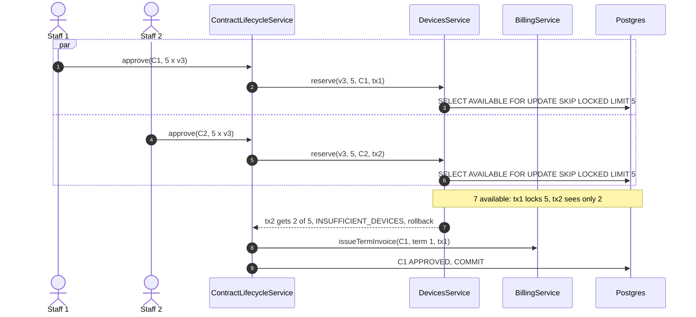

***Figure 3***: E01-1. `SKIP LOCKED` makes the loser count only unlocked rows, so it fails fast instead of
waiting and then over-allocating.

---

## 9. Testing strategy

Lifecycle matrix; the approval race on Postgres; term rollover across month ends (31 to 30 days) and
across a scheduler outage; overdue and default timing with a fake clock; close guards through stubbed
ports; holder labels erased on close.

---

## 10. Detailed design for Report 4 (D-044)

Layering follows `organizations` design §9. The class views are split by MF-01 and MF-05; the following sequences cover the contract interactions and the two scheduled jobs. Controller names follow the rebased implementation, including HandoverController and ReturnController.

<!-- sdd: MF-01 class rentals -->
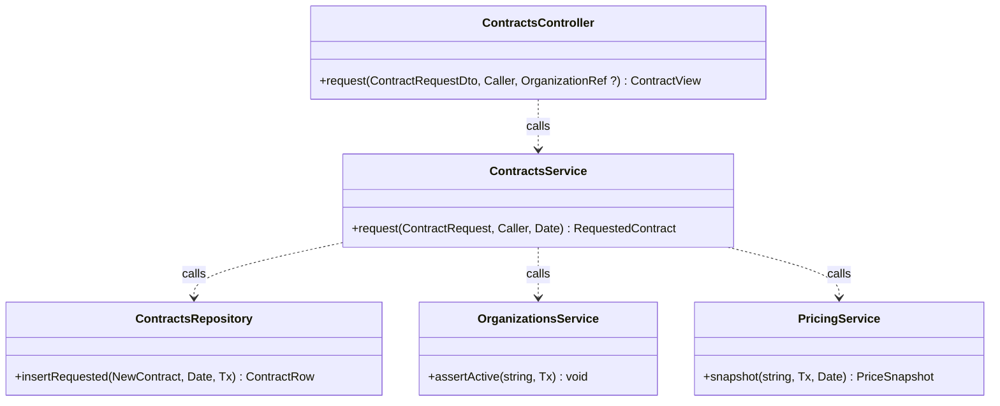

***Figure 4***: rentals classes used in MF-01, UC-15. Dependencies are call-only (`..>`). Parameter types are listed in source order; `Tx` means `Prisma.TransactionClient`, and a result or structural type the code leaves unnamed is named after what it holds. The source remains authoritative for defaults, optional arguments and full type shapes.

<!-- sdd: MF-01 class rentals-uc-17 -->
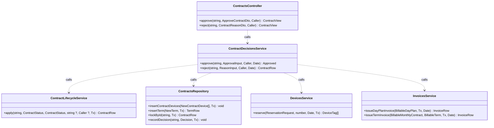

***Figure 5***: rentals classes used in MF-01, UC-17. Dependencies are call-only (`..>`). Parameter types are listed in source order; `Tx` means `Prisma.TransactionClient`, and a result or structural type the code leaves unnamed is named after what it holds. The source remains authoritative for defaults, optional arguments and full type shapes.

<!-- sdd: MF-01 class rentals-uc-20-part-1-of-2 -->
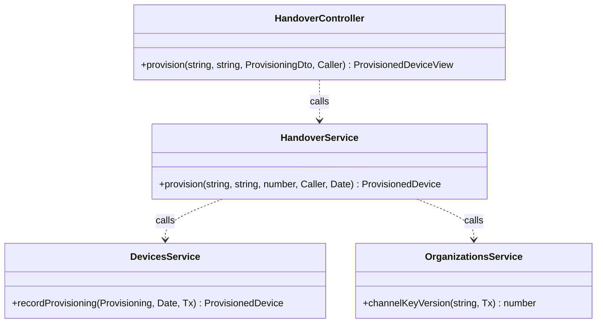

***Figure 6***: rentals classes used in MF-01, UC-20 part 1 of 2. Dependencies are call-only (`..>`). Parameter types are listed in source order; `Tx` means `Prisma.TransactionClient`, and a result or structural type the code leaves unnamed is named after what it holds. The source remains authoritative for defaults, optional arguments and full type shapes.

<!-- sdd: MF-01 class rentals-uc-20-part-2-of-2 -->
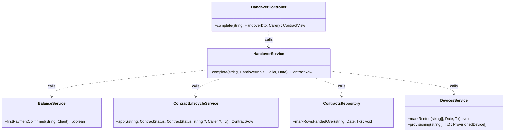

***Figure 7***: rentals classes used in MF-01, UC-20 part 2 of 2. Dependencies are call-only (`..>`). Parameter types are listed in source order; `Tx` means `Prisma.TransactionClient`, and a result or structural type the code leaves unnamed is named after what it holds. The source remains authoritative for defaults, optional arguments and full type shapes.

<!-- sdd: MF-01 class rentals-uc-16 -->
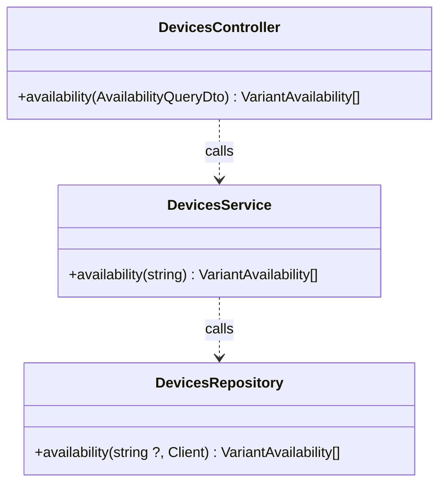

***Figure 8***: rentals classes used in MF-01, UC-16. Dependencies are call-only (`..>`). Parameter types are listed in source order; `Tx` means `Prisma.TransactionClient`, and a result or structural type the code leaves unnamed is named after what it holds. The source remains authoritative for defaults, optional arguments and full type shapes.

<!-- sdd: MF-01 class rentals-uc-18 -->
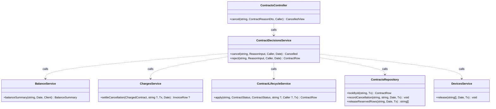

***Figure 9***: rentals classes used in MF-01, UC-18. Dependencies are call-only (`..>`). Parameter types are listed in source order; `Tx` means `Prisma.TransactionClient`, and a result or structural type the code leaves unnamed is named after what it holds. The source remains authoritative for defaults, optional arguments and full type shapes.

<!-- sdd: MF-01 class rentals-uc-25 -->
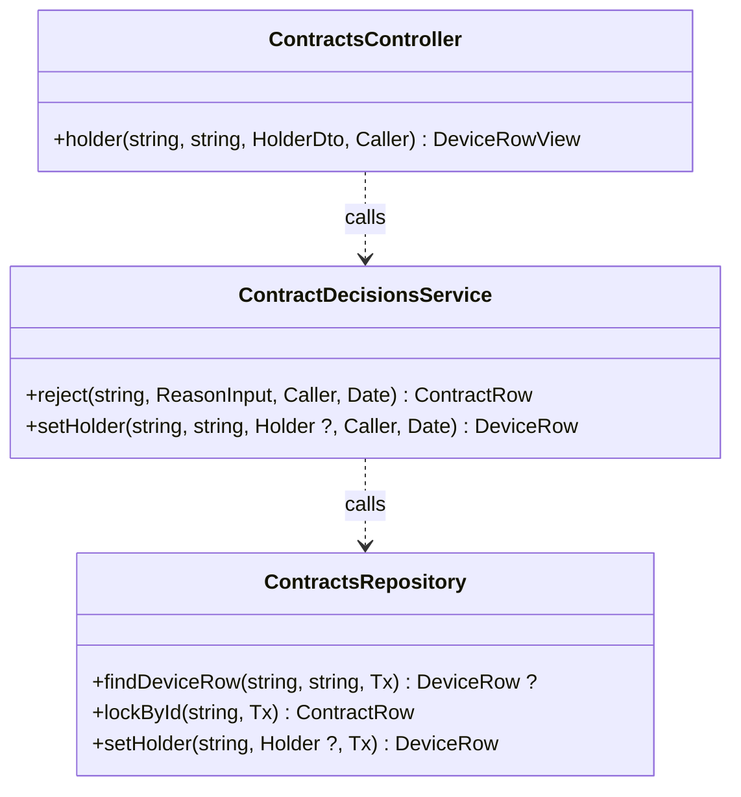

***Figure 10***: rentals classes used in MF-01, UC-25. Dependencies are call-only (`..>`). Parameter types are listed in source order; `Tx` means `Prisma.TransactionClient`, and a result or structural type the code leaves unnamed is named after what it holds. The source remains authoritative for defaults, optional arguments and full type shapes.

<!-- sdd: MF-05 class rentals -->
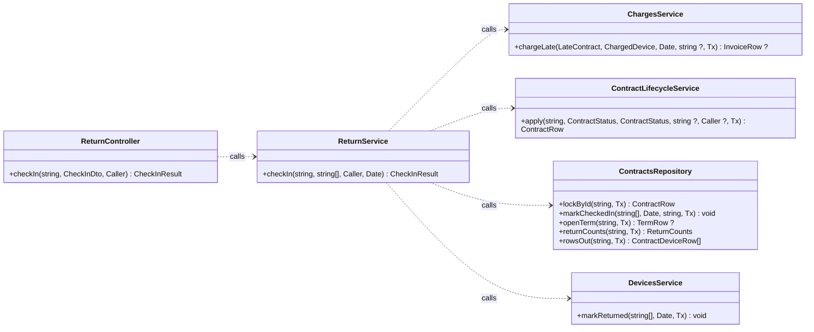

***Figure 11***: rentals classes used in MF-05, UC-43. Dependencies are call-only (`..>`). Parameter types are listed in source order; `Tx` means `Prisma.TransactionClient`, and a result or structural type the code leaves unnamed is named after what it holds. The source remains authoritative for defaults, optional arguments and full type shapes.

<!-- sdd: MF-05 class rentals-uc-51 -->
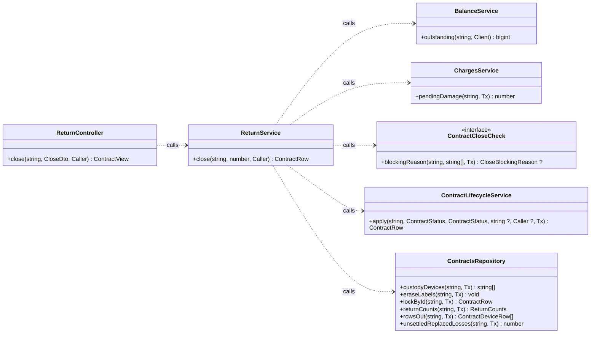

***Figure 12***: rentals classes used in MF-05, UC-51. Dependencies are call-only (`..>`). Parameter types are listed in source order; `Tx` means `Prisma.TransactionClient`, and a result or structural type the code leaves unnamed is named after what it holds. The source remains authoritative for defaults, optional arguments and full type shapes.

<!-- sdd: MF-05 class rentals-uc-61 -->
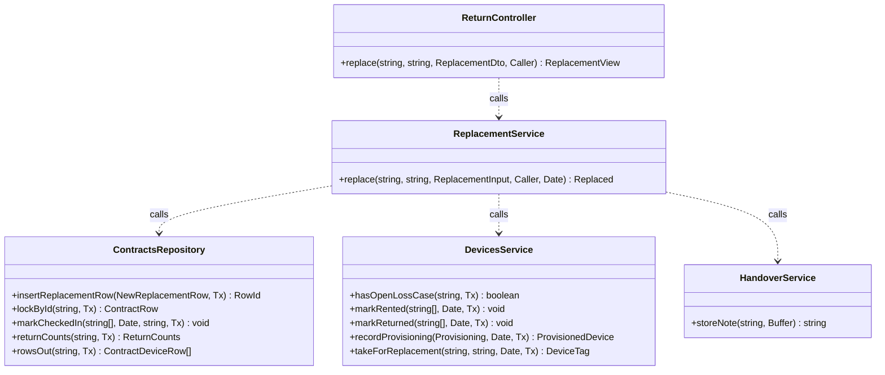

***Figure 13***: rentals classes used in MF-05, UC-61. Dependencies are call-only (`..>`). Parameter types are listed in source order; `Tx` means `Prisma.TransactionClient`, and a result or structural type the code leaves unnamed is named after what it holds. The source remains authoritative for defaults, optional arguments and full type shapes.

<!-- sdd: MF-05 class rentals-uc-23 -->
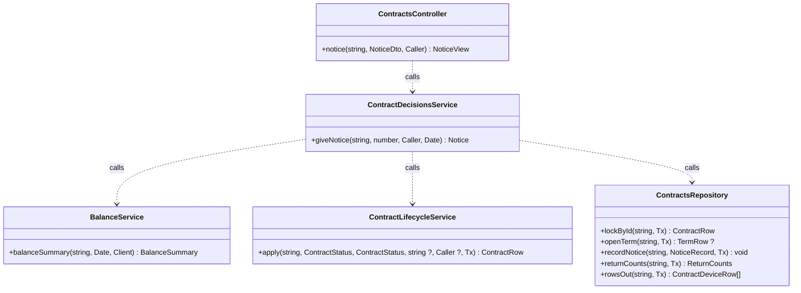

***Figure 14***: rentals classes used in MF-05, UC-23. Dependencies are call-only (`..>`). Parameter types are listed in source order; `Tx` means `Prisma.TransactionClient`, and a result or structural type the code leaves unnamed is named after what it holds. The source remains authoritative for defaults, optional arguments and full type shapes.

<!-- sdd: MF-05 class rentals-uc-24 -->
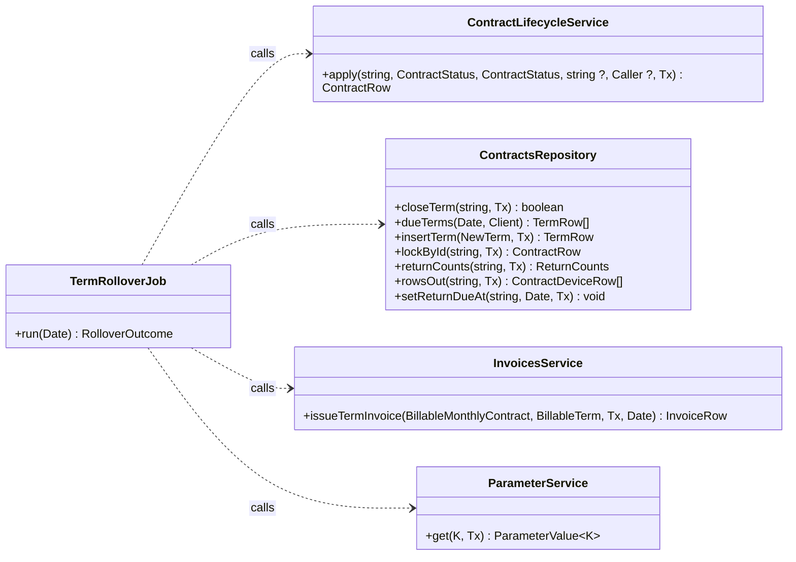

***Figure 15***: rentals classes used in MF-05, UC-24. Dependencies are call-only (`..>`). Parameter types are listed in source order; `Tx` means `Prisma.TransactionClient`, and a result or structural type the code leaves unnamed is named after what it holds. The source remains authoritative for defaults, optional arguments and full type shapes.

<!-- sdd: MF-05 class rentals-uc-50 -->
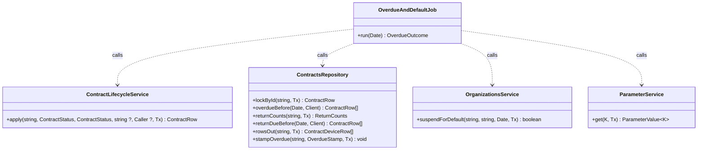

***Figure 16***: rentals classes used in MF-05, UC-50. Dependencies are call-only (`..>`). Parameter types are listed in source order; `Tx` means `Prisma.TransactionClient`, and a result or structural type the code leaves unnamed is named after what it holds. The source remains authoritative for defaults, optional arguments and full type shapes.


<!-- sdd: MF-01 seq UC-15 -->
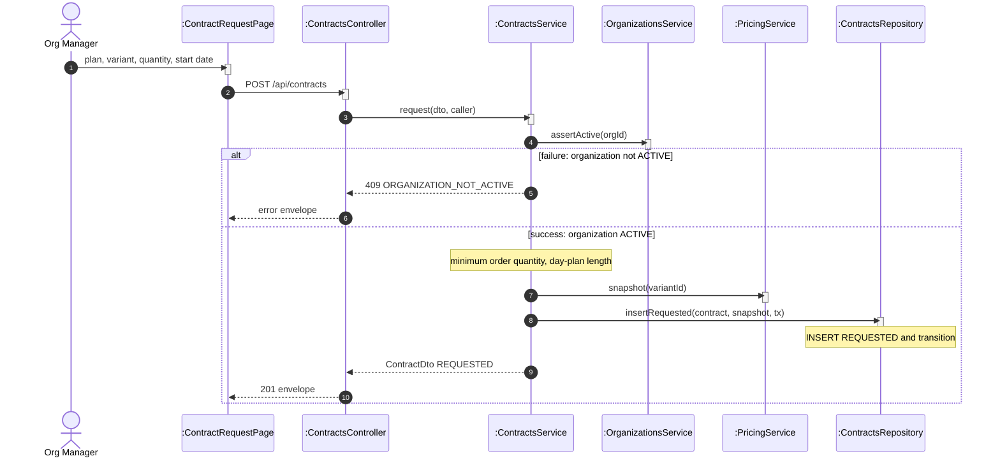

***Figure 17***: UC-15 Request Rental Contract. The quote shown before the request is `POST /api/quotes`,
answered by `PricingService.quote`.

<!-- sdd: MF-01 seq UC-17 -->
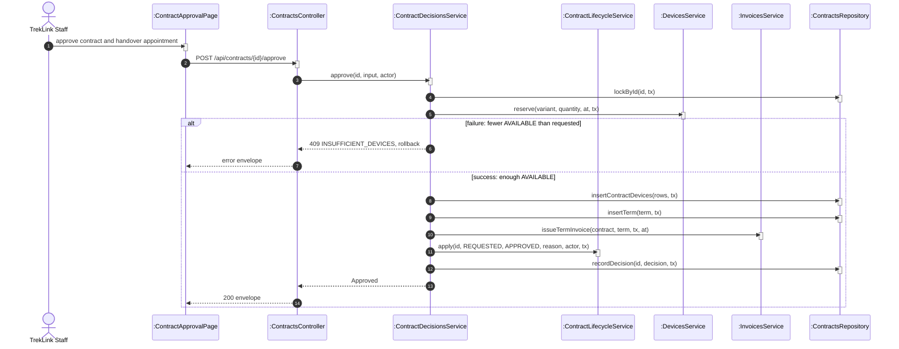

***Figure 18***: UC-17 Approve Rental Contract. ContractDecisionsService reserves AVAILABLE devices with SKIP LOCKED and delegates the transition to ContractLifecycleService.apply. The monthly success path issues term 1; a day plan calls InvoicesService.issueDayPlanInvoice instead. Stale versions and non-REQUESTED contracts are refused before reservation.

<!-- sdd: MF-01 seq UC-20 part 1 of 2: provisioning -->
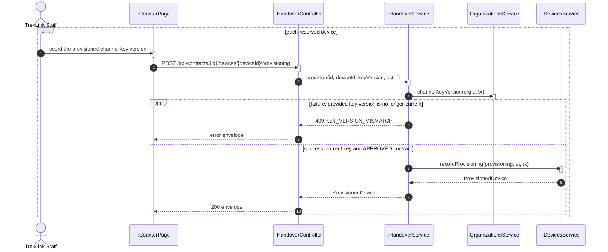

***Figure 19***: UC-20 Hand Over Devices, part 1 of 2: UC-14 Provision Device for each reserved device. HandoverService verifies the APPROVED contract and its device row before comparing the submitted key version to the organization current version. A stale key is 409 KEY_VERSION_MISMATCH; only the version is recorded, never the channel secret.

<!-- sdd: MF-01 seq UC-20 part 2 of 2: signed handover -->
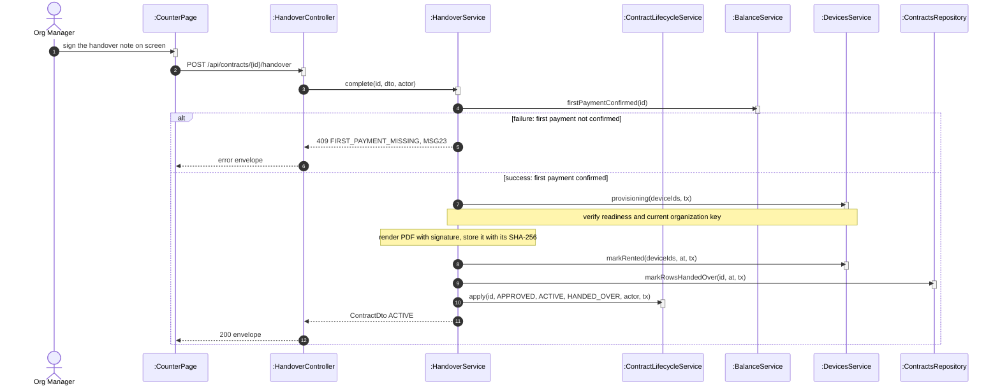

***Figure 20***: UC-20 Hand Over Devices, part 2 of 2: UC-21 Sign Handover Note and activation.
`markRowsHandedOver` opens each device's custody interval (D-040).

<!-- sdd: MF-05 seq UC-43 -->
```mermaid
sequenceDiagram
    autonumber
    actor St as TrekLink Staff
    participant P as :CounterPage
    participant C as :ReturnController
    participant S as :ReturnService
    participant D as :DevicesService
    participant Ch as :ChargesService
    participant L as :ContractLifecycleService
    participant R as :ContractsRepository
    St->>P: scan returned asset tags
    activate P
    deactivate P
    P->>C: POST /api/contracts/{id}/check-ins
    activate C
    deactivate C
    C->>S: checkIn(id, assetTags, actor)
    activate S
    deactivate S
    S->>R: lockById(id, tx)
    activate R
    deactivate R
    alt failure: tag not on this contract
        S-->>C: 409 DEVICE_NOT_ON_CONTRACT, MSG12
        C-->>P: error envelope
    else success: tag on this contract
        S->>R: openTerm(id, tx)
        activate R
        deactivate R
        S->>R: markCheckedIn(rowIds, at, actorId, tx)
        activate R
        deactivate R
        S->>D: markReturned(deviceIds, at, tx)
        activate D
        deactivate D
        loop each returned device when an effective due date exists
            S->>Ch: chargeLate(contract, device, checkedInAt, actorId, tx)
            activate Ch
            deactivate Ch
        end
        S->>R: returnCounts(id, tx)
        activate R
        deactivate R
        S->>L: apply(id, current, RETURNED, CHECKED_IN, actor, tx)
        activate L
        deactivate L
        S-->>C: CheckInResult
        C-->>P: 200 envelope
    end
```

***Figure 21***: UC-43 Check In Device. `markCheckedIn` closes the custody interval (D-040); late events
from the organization's Field Station are still attributed to it. The transition to `RETURNED` runs only
once every device of the contract is back or lost; until then the contract keeps its state.
An ACTIVE day plan or ENDING contract without `returnDueAt` reads the open term before check-in writes;
when its end is earlier than the actual return, that end is the effective late-fee deadline. A missing
open term aborts before mutation. Returning before the term end adds no late fee. This preserves fees
when check-in happens before the daily rollover batch; each bulk check-in operation runs once.

<!-- sdd: MF-05 seq UC-51 -->
```mermaid
sequenceDiagram
    autonumber
    actor St as TrekLink Staff
    participant P as :ContractDetailPage
    participant C as :ReturnController
    participant S as :ReturnService
    participant L as :ContractLifecycleService
    participant B as :BalanceService
    participant Ch as :ChargesService
    participant K as :ContractCloseCheck
    participant R as :ContractsRepository
    St->>P: close contract
    activate P
    deactivate P
    P->>C: POST /api/contracts/{id}/close
    activate C
    deactivate C
    C->>S: close(id, expectedVersion, actor)
    activate S
    deactivate S
    S->>R: lockById(id, tx)
    activate R
    deactivate R
    Note over R: BEGIN, SELECT contract FOR UPDATE
    S->>B: outstanding(id, tx)
    activate B
    deactivate B
    S->>R: custodyDevices(id, tx)
    activate R
    deactivate R
    S->>R: unsettledReplacedLosses(id, tx)
    activate R
    deactivate R
    S->>Ch: pendingDamage(id, tx)
    activate Ch
    deactivate Ch
    S->>K: blockingReason(id, deviceIds, tx)
    activate K
    deactivate K
    Note over K: billing reports a balance, incidents report an open incident
    alt failure: a check blocks
        S-->>C: 409 BALANCE_OUTSTANDING or OPEN_INCIDENTS
        C-->>P: error envelope
    else success: every check passes
        S->>R: eraseLabels(id, tx)
        activate R
        deactivate R
        S->>L: apply(id, RETURNED, CLOSED, CLOSED, actor, tx)
        activate L
        deactivate L
        Note over R: UPDATE, INSERT transition, COMMIT
        S-->>C: ContractDto CLOSED
        C-->>P: 200 envelope
    end
```

***Figure 22***: UC-51 Close Rental Contract.

<!-- sdd: MF-05 seq UC-61 -->
```mermaid
sequenceDiagram
    autonumber
    actor St as TrekLink Staff
    participant P as :CounterPage
    participant C as :ReturnController
    participant S as :ReplacementService
    participant H as :HandoverService
    participant D as :DevicesService
    participant R as :ContractsRepository
    St->>P: choose a replacement and capture the Manager signature
    activate P
    deactivate P
    P->>C: POST /api/contracts/{id}/devices/{deviceId}/replacement
    activate C
    deactivate C
    C->>S: replace(id, deviceId, input, actor)
    activate S
    deactivate S
    S->>R: lockById(id, tx)
    activate R
    deactivate R
    S->>R: rowsOut(id, tx)
    activate R
    deactivate R
    S->>D: takeForReplacement(newDeviceId, variantId, at, tx)
    activate D
    deactivate D
    S->>D: hasOpenLossCase(deviceId, tx)
    activate D
    deactivate D
    alt failure: missing faulty unit has no open loss case
        S-->>C: 409 LOSS_CASE_REQUIRED, rollback
        C-->>P: error envelope
    else success: faulty unit present or its loss case is open
        S->>R: markCheckedIn([oldRowId], at, actorId, tx)
        activate R
        deactivate R
        S->>D: markReturned([deviceId], at, tx)
        activate D
        deactivate D
        S->>D: recordProvisioning(provisioning, at, tx)
        activate D
        deactivate D
        S->>D: markRented([newDeviceId], at, tx)
        activate D
        deactivate D
        Note over S,H: render replacement note with signature and SHA-256
        S->>H: storeNote(name, pdf)
        activate H
        deactivate H
        S->>R: insertReplacementRow(row, tx)
        activate R
        deactivate R
        S-->>C: replacement row and signed note
        C-->>P: 201 envelope
    end
```

***Figure 23***: UC-61 Replace Device on Contract. The new row opens its custody interval with replacesId; plan, variant and quantity remain unchanged (BR-41). A missing faulty device needs an open loss case (409 LOSS_CASE_REQUIRED); `hasOpenLossCase` is read only when the faulty unit is missing, and `markCheckedIn` with `markReturned` run only when it is at the counter. The service also checks the running contract, replacement availability and organization key before completing the exchange; those additional refusals are outside these two lanes.

<!-- sdd: MF-01 seq UC-16 -->
```mermaid
sequenceDiagram
    autonumber
    actor St as TrekLink Staff
    participant P as :ContractApprovalPage
    participant C as :DevicesController
    participant S as :DevicesService
    participant R as :DevicesRepository
    St->>P: select a requested contract
    activate P
    deactivate P
    P->>C: GET /api/devices/availability?hardwareVariantId={id}
    activate C
    deactivate C
    C->>S: availability(hardwareVariantId)
    activate S
    deactivate S
    S->>R: availability(hardwareVariantId)
    activate R
    deactivate R
    R-->>S: AVAILABLE units per variant
    S-->>C: counts
    C-->>P: 200 envelope
    alt success: enough AVAILABLE units for the requested quantity
        P->>St: show the count beside Approve
    else failure: fewer AVAILABLE units than requested
        P->>St: warn before Approve, which the server refuses with 409 INSUFFICIENT_DEVICES (UC-17)
    end
```

***Figure 24***: UC-16 Verify Device Availability. The count is advisory; the reservation at approval is
the check that holds (§8). The Org Manager reads the same counts with `device.availability.org`.

<!-- sdd: MF-01 seq UC-18 -->
```mermaid
sequenceDiagram
    autonumber
    actor A as Org Manager or TrekLink Staff
    participant P as :ContractDetailPage
    participant C as :ContractsController
    participant S as :ContractDecisionsService
    participant L as :ContractLifecycleService
    participant D as :DevicesService
    participant Ch as :ChargesService
    participant B as :BalanceService
    participant R as :ContractsRepository
    A->>P: cancel the contract with a reason
    activate P
    deactivate P
    P->>C: POST /api/contracts/{id}/cancel
    activate C
    deactivate C
    C->>S: cancel(id, dto, caller)
    activate S
    deactivate S
    S->>R: lockById(id, tx)
    activate R
    deactivate R
    alt failure: another organization's contract
        S-->>C: 404 NOT_FOUND
        C-->>P: error envelope
    else success: authorized, current version, cancellable state
        S->>L: apply(id, status, CANCELLED, reason, actor, tx)
        activate L
        deactivate L
        S->>R: releaseReservedRows(id, at, tx)
        activate R
        deactivate R
        S->>D: release(deviceIds, at, tx)
        activate D
        deactivate D
        S->>Ch: settleCancellation(contract, actorId, tx, at)
        activate Ch
        deactivate Ch
        S->>R: recordCancellation(id, reason, at, tx)
        activate R
        deactivate R
        S->>B: balanceSummary(id, at, tx)
        activate B
        deactivate B
        S-->>C: contract CANCELLED, retainedVnd
        C-->>P: 200 envelope
    end
```

***Figure 25***: UC-18 Cancel Rental Contract. Reserved units return to AVAILABLE; a negative ADJUSTMENT on the closing invoice voids unpaid first-invoice lines, while a paid holding fee stays retained (FR-CON-04, REQ-EVT-11). Outside the named ownership failure, a stale version returns 409 STALE_VERSION and any state other than REQUESTED or APPROVED returns 409 INVALID_STATE_TRANSITION. Every refusal rolls the transaction back.

<!-- sdd: MF-01 seq UC-25 -->
```mermaid
sequenceDiagram
    autonumber
    actor M as Org Manager
    participant P as :ContractDetailPage
    participant C as :ContractsController
    participant S as :ContractDecisionsService
    participant R as :ContractsRepository
    M->>P: enter or clear the holder label
    activate P
    deactivate P
    P->>C: PUT /api/contracts/{id}/devices/{deviceId}/holder
    activate C
    deactivate C
    C->>S: setHolder(id, deviceId, holder, caller)
    activate S
    deactivate S
    S->>R: lockById(id, tx)
    activate R
    deactivate R
    S->>R: findDeviceRow(id, deviceId, tx)
    activate R
    deactivate R
    alt failure: CLOSED contract or device not out
        S-->>C: 409 INVALID_STATE_TRANSITION
        C-->>P: error envelope
    else success: contract not CLOSED and device still out
        S->>R: setHolder(rowId, holder, tx)
        activate R
        deactivate R
        Note over S,R: emit device.labelChanged after commit
        S-->>C: device row with its label
        C-->>P: 200 envelope
    end
```

***Figure 26***: UC-25 Label Device Holder. A device is out when handedOverAt is set and checkedInAt and lostAt are null; the contract need not be ACTIVE. Ownership is checked first (404 NOT_FOUND), then membership of the device (409 DEVICE_NOT_ON_CONTRACT), before the named state failure. Labels are erased when the contract closes (BR-33).

<!-- sdd: MF-05 seq UC-23 -->
```mermaid
sequenceDiagram
    autonumber
    actor M as Org Manager
    participant P as :ContractDetailPage
    participant C as :ContractsController
    participant S as :ContractDecisionsService
    participant L as :ContractLifecycleService
    participant B as :BalanceService
    participant R as :ContractsRepository
    M->>P: give notice
    activate P
    deactivate P
    P->>C: POST /api/contracts/{id}/notice
    activate C
    deactivate C
    C->>S: giveNotice(id, expectedVersion, caller)
    activate S
    deactivate S
    S->>R: lockById(id, tx)
    activate R
    deactivate R
    alt failure: day plan ends on its own
        S-->>C: 409 DAY_PLAN_NO_NOTICE
        C-->>P: error envelope
    else success: monthly ACTIVE contract with an open term
        S->>R: openTerm(id, tx)
        activate R
        deactivate R
        S->>L: apply(id, ACTIVE, ENDING, NOTICE, actor, tx)
        activate L
        deactivate L
        S->>R: recordNotice(id, notice, tx)
        activate R
        deactivate R
        S->>B: balanceSummary(id, at, tx)
        activate B
        deactivate B
        S-->>C: ENDING contract, term, dueAtEndVnd
        C-->>P: 200 envelope
    end
```

***Figure 27***: UC-23 Give Cancellation Notice. The current term is not shortened; the contract ends at its term end and the remaining term balance falls due then (REQ-EVT-07, MSG18). Other-organization requests return 404, stale versions return 409 STALE_VERSION, and a non-ACTIVE contract or absent open term returns 409 INVALID_STATE_TRANSITION outside this two-lane view.

<!-- sdd: MF-05 seq UC-24 -->
```mermaid
sequenceDiagram
    autonumber
    participant J as :TermRolloverJob
    participant Pm as :ParameterService
    participant R as :ContractsRepository
    participant I as :InvoicesService
    J->>Pm: get(rentals.termRolloverHourLocal)
    activate Pm
    deactivate Pm
    Note over J,R: cutoff is the latest configured daily boundary in UTC+7
    J->>R: dueTerms(cutoff)
    activate R
    deactivate R
    R-->>J: open terms that have ended, on ACTIVE or ENDING contracts
    loop each due term of a monthly contract still ACTIVE, one transaction each
        J->>R: lockById(contractId, tx)
        activate R
        deactivate R
        J->>R: closeTerm(termId, tx)
        activate R
        deactivate R
        alt failure: another run already closed this term
            Note over J,R: skip this term without another invoice
        else success: this run closed the term
            J->>R: insertTerm(seq + 1, starts at the old end, one month long, tx)
            activate R
            deactivate R
            J->>I: issueTermInvoice(contract, next term, tx)
            activate I
            deactivate I
        end
    end
```

***Figure 28***: UC-24 Roll Over Monthly Term. Each hourly wakeup selects terms due by the most recent
configured daily cutoff in UTC+7. A run before today's configured hour catches up yesterday's batch;
terms ending after that cutoff wait until the next daily batch. A due term of an `ENDING` contract
(notice given) or a day plan does not renew: the job closes the term, sets `returnDueAt` to the term end
and applies `RETURN_DUE` with reason `TERM_ENDED` through `ContractLifecycleService.apply`; when
`returnCounts` shows every device already back, it applies `RETURNED` with `ALL_DEVICES_BACK` in the same
transaction. If another run already closed the selected term, the compare-and-set fails and this
run skips it without inserting another term or invoice.

<!-- sdd: MF-05 seq UC-50 -->
```mermaid
sequenceDiagram
    autonumber
    participant J as :OverdueAndDefaultJob
    participant Pm as :ParameterService
    participant R as :ContractsRepository
    participant L as :ContractLifecycleService
    participant O as :OrganizationsService
    J->>Pm: get(rentals.returnGraceHours)
    activate Pm
    deactivate Pm
    J->>Pm: get(rentals.defaultAfterDays)
    activate Pm
    deactivate Pm
    J->>Pm: get(rentals.termRolloverHourLocal)
    activate Pm
    deactivate Pm
    Note over J,R: cutoff is the latest configured daily boundary in UTC+7
    J->>R: returnDueBefore(cutoff minus grace)
    activate R
    deactivate R
    loop each contract past grace, still RETURN_DUE with devices out, one transaction
        J->>R: lockById(id, tx)
        activate R
        deactivate R
        J->>R: rowsOut(id, tx)
        activate R
        deactivate R
        J->>L: apply(id, RETURN_DUE, OVERDUE, GRACE_ELAPSED, null, tx)
        activate L
        deactivate L
        J->>R: stampOverdue(id, overdueStamp, tx)
        activate R
        deactivate R
    end
    J->>R: overdueBefore(cutoff minus default threshold)
    activate R
    deactivate R
    loop each default candidate, one transaction
        J->>R: lockById(id, tx)
        activate R
        deactivate R
        alt success: locked contract is still OVERDUE
            J->>L: apply(id, OVERDUE, DEFAULTED, DEFAULT_THRESHOLD, null, tx)
            activate L
            deactivate L
            J->>R: stampOverdue(id, defaultStamp, tx)
            activate R
            deactivate R
            J->>O: suspendForDefault(orgId, code, now, tx)
            activate O
            deactivate O
        else failure to default: another operation changed its state
            Note over J,R: skip this candidate without a transition
        end
    end
```

***Figure 29***: UC-50 Default Overdue Contract. A defaulted contract suspends its organization. The named failure is a candidate whose locked state is no longer OVERDUE, so the job skips it without writes; compare-and-set transitions keep reruns idempotent. In the first loop, a contract that the lock shows no longer `RETURN_DUE`, or with every device back (`rowsOut`), is skipped the same way. Reactivation waits until the organization has nothing outstanding (Report 3 organization lifecycle).
